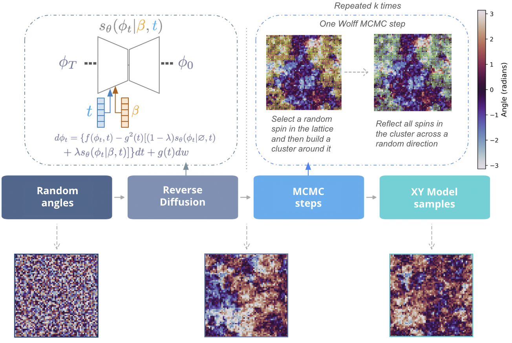

# Diffusion-warm sampling of the XY model enables fast thermalization at scale

Implementation of [Diffusion-warm sampling of the XY model enables fast thermalization at scale](https://arxiv.org/abs/2606.30773) (NeurIPS 2026 main track poster) by Sehmimul Hoque, Roger Melko and Pooya Ronagh.



We introduce a novel technique for scalable sampling of spin-system states with continuous symmetries using diffusion models. By applying our approach to the XY model, a fundamental continuous-spin model in condensed matter physics, we show that our technique addresses the shortfalls of the Markov chain Monte Carlo (MCMC) in generalization to varying system sizes. More specifically, we show that training a temperature-conditioned diffusion model on smaller-size XY model lattices enables the generation of accurate samples in larger lattice sizes. By tracking physically important observables of the model, such as spin correlations, our experiments demonstrate that diffusion sampling followed by a few MCMC steps reduces the thermalization time by an order of magnitude relative to the standard MCMC with random initialization. Our study provides valuable insight as to how generative models can be used to study continuous-state condensed matter systems at scale.

## How it works

A forward process gradually adds noise to equilibrium spin configurations, whose angles live on the torus. A neural network learns to estimate the score of the resulting noisy distributions at each noise level. Temperature is also used as a conditional variable to avoid training different models at different temperature. We train this conditional diffusion model using Classifier Free Guidance (CFG) technique. At generation time, we use reverse diffusion to iteratively generate samples. In this work we are interested in size extrapolation. Hence we use a CNN based score network as they allow size extrapolation. We further impose constraints on the score network to make it rotationally invariant and with periodic boundary conditions to account for the symmetry in the XY model data samples.
Then we are able to generate samples at larger sizes using the trained network. However, the samples produced at the extrapolated sizes are not accurate XY model samples. They instead provide a very good warm start for MCMC which ultimately leads to faster thermalization as discussed in the paper.

## Getting started

Create and activate a virtual environment with `Python 3.6.8` and install the project dependencies from `requirements.txt`. The `config.py` file as training and sampling configurations which can be modified. Additionally, note that `wandb` has been used for experiment tracking. To generate the data using Wolff MCMC please run the following:

```bash
python3 wolff_mcmc.py
```


To run the train script, please run the following commands which saves a checkpoint in `asssets/`:

```bash
python3 train.py --data_type xy
```

To generate samples using a trained model, please run the following command and the experiment results can be tracked through wandb:

```bash
python3 sample.py
```

Please feel free to create issues or reach out by [email](mailto:s4hoque@uwaterloo.ca) for any questions.

## Project contents

The repository contains the implementation and experiment files for this project. See the source code and configuration files for details about supported datasets, architectures, and samplers.

| Directory        | Content    | 
| ------------- |:-------------| 
| `assets/`      | Trained checkpoint and training data saved here | 
| `data/` | Data manager and loader |
| `lib/`  | Helper functions for diffusion model trainig and sampling and MCMC helper functions |
| `sandbox/` | Scripts for future work and testing |
| `config.py` | Configuration file for training and sampling |
| `requirements.txt`  | Required libraries |
| `train.py` | Main training script |
| `sample.py` | Sampling script |
| `wolff_mcmc.py` | Script to generate data using Wolff MCMC |
| `training_step.py` | One step of training |

## Citation

If you use the code, please consider citing

```bibtex
@inproceedings{
hoque2026diffusionwarm,
title={Diffusion-warm sampling of the {XY} model enables fast thermalization at scale},
author={Sehmimul Hoque and Roger Melko and Pooya Ronagh},
booktitle={The Fortieth Annual Conference on Neural Information Processing Systems},
year={2026},
url={https://openreview.net/forum?id=3vCVCEk7Px}
}
```